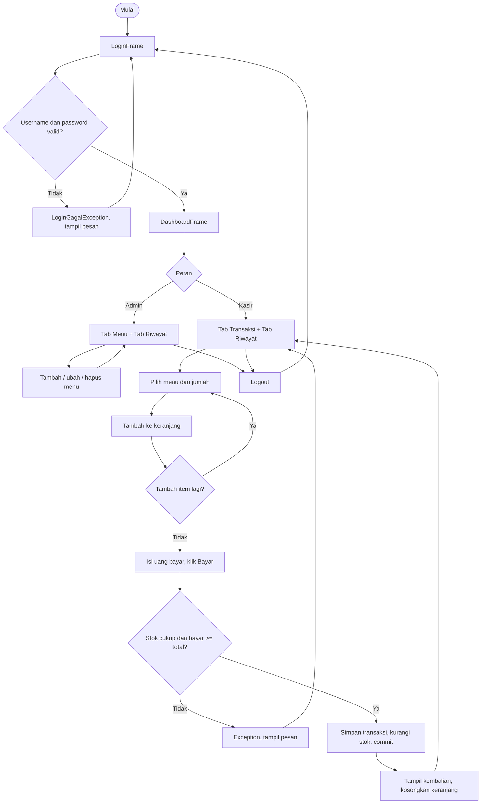
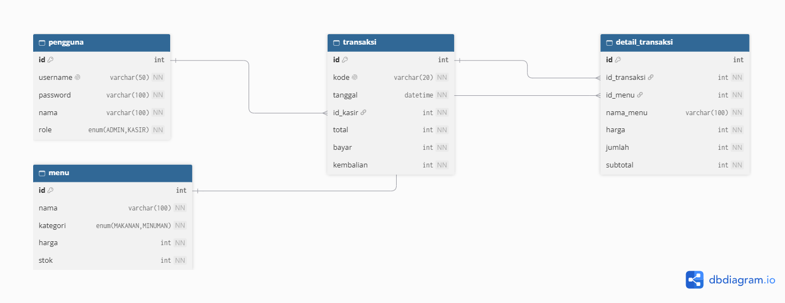
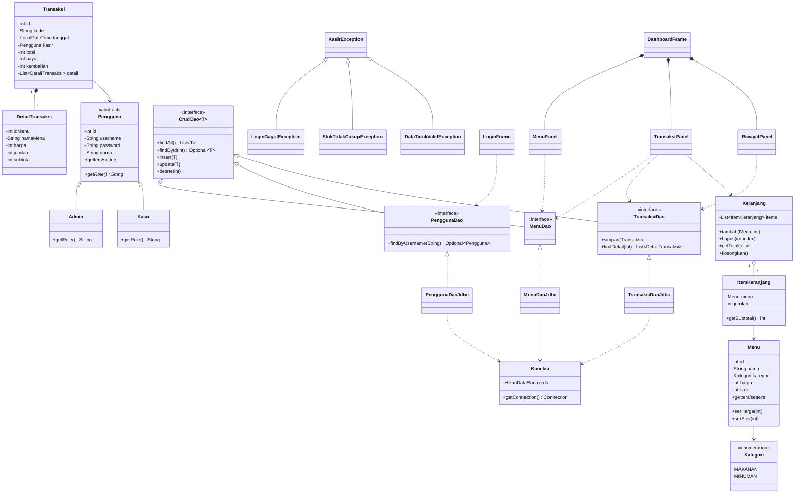

# Kakabir: Kasir Kantin Biru

Proyek Praktikum Pemrograman Berorientasi Objek 2026.

**Kelompok BadGenius**

| Nama | NPM |
|---|---|
| Farrel Athariz Saffa | 140810250026 |
| Jovanic Adriel Harjanto | 140810250050 |
| Mochammad Ziyad Zayid Arully | 140810250065 |

**Teknologi:** Java (Maven), Swing, MySQL (Laragon), JDBC + HikariCP.
Materi dibatasi pada slide praktikum minggu 1 sampai 9.

---

## 1. Ide dan Deskripsi

Kantin Biru masih mencatat pesanan dan menghitung uang secara manual, sehingga rawan salah hitung dan stok sulit dipantau. **Kakabir** adalah aplikasi desktop kasir sederhana yang membantu pencatatan menu, transaksi penjualan, dan riwayat penjualan.

**Pengguna aplikasi**

| Peran | Hak akses |
|---|---|
| Admin | Kelola menu (tambah, ubah, hapus), lihat riwayat transaksi |
| Kasir | Melayani transaksi, lihat riwayat transaksi |

## 2. Fungsionalitas

| Kode | Fitur | Deskripsi |
|---|---|---|
| F1 | Login | Masuk dengan username dan password. Gagal login menampilkan pesan dari exception. Setelah masuk, tab yang tampil mengikuti peran. |
| F2 | Kelola menu | Admin menambah, mengubah, menghapus, dan melihat menu (nama, kategori, harga, stok) pada `JTable`. Input divalidasi (harga dan stok tidak boleh negatif, nama wajib diisi). |
| F3 | Transaksi | Kasir memilih menu dan jumlah lalu menambahkannya ke keranjang. Keranjang bisa dihapus per baris. Total dihitung otomatis, kasir mengisi uang bayar, kembalian dihitung otomatis. |
| F4 | Simpan transaksi | Menyimpan transaksi dan detailnya, lalu mengurangi stok menu. Semuanya dalam satu transaksi database (commit atau rollback). Stok tidak cukup atau uang bayar kurang ditolak lewat exception. |
| F5 | Riwayat | Daftar transaksi (kode, tanggal, kasir, total). Memilih satu baris menampilkan detail itemnya. |
| F6 | Logout | Kembali ke layar login. |

## 3. Alur Aplikasi



**Alur menyimpan transaksi (F4):**

1. `TransaksiPanel` membuat objek `Transaksi` dari `Keranjang`.
2. `TransaksiDaoJdbc.simpan()` membuka koneksi dari pool dan `setAutoCommit(false)`.
3. Insert baris `transaksi`, lalu insert tiap `detail_transaksi`.
4. Untuk tiap item: `UPDATE menu SET stok = stok - ? WHERE id = ? AND stok >= ?`. Jika tidak ada baris terubah, lempar `StokTidakCukupException`.
5. Semua berhasil: `commit()`. Ada kegagalan: `rollback()`. Koneksi dikembalikan ke pool di blok `finally`.

## 4. Rancangan Database



## 5. Rancangan Class

### 5.1 Struktur paket

```
com.badgenius.kakabir
├── Main.java
├── db         Koneksi                    (HikariCP, singleton)
├── model      Pengguna, Admin, Kasir, Menu, Keranjang, ItemKeranjang,
│              Transaksi, DetailTransaksi, Kategori (enum)
├── dao        CrudDao<T>, MenuDao, PenggunaDao, TransaksiDao
│              + implementasi *DaoJdbc
├── exception  KasirException, LoginGagalException,
│              StokTidakCukupException, DataTidakValidException
└── view       LoginFrame, DashboardFrame, MenuPanel, TransaksiPanel, RiwayatPanel
```

### 5.2 Diagram class



### 5.3 Peran tiap bagian

| Bagian | Tanggung jawab |
|---|---|
| `model` | Menyimpan data dan aturan sederhana (validasi di setter, hitung subtotal dan total). Atribut `private`. |
| `dao` | Satu-satunya tempat yang memakai SQL. Hasil pencarian tunggal dikembalikan sebagai `Optional`. |
| `exception` | Kesalahan aplikasi bertipe checked, pesannya langsung ditampilkan lewat `JOptionPane`. |
| `db.Koneksi` | Membuat pool koneksi sekali, dipakai semua DAO. |
| `view` | Hanya urusan tampilan dan event. Logika data dipanggil lewat DAO dan model. |

## 6. Rencana Pengerjaan

| Tahap | Isi | Issue / PR |
|---|---|---|
| 1 | Scaffolding Maven, `schema.sql`, `Koneksi` (HikariCP), `Main` | Setup proyek |
| 2 | Model, exception, DAO pengguna, `LoginFrame` | F1 |
| 3 | `Menu`, `MenuDao`, `MenuPanel` | F2 |
| 4 | `Keranjang`, `TransaksiPanel`, `TransaksiDao.simpan` | F3, F4 |
| 5 | `RiwayatPanel`, `DashboardFrame` dengan hak akses per peran, logout | F5, F6 |
| 6 | README, tangkapan layar, pengecekan akhir | Dokumentasi |
